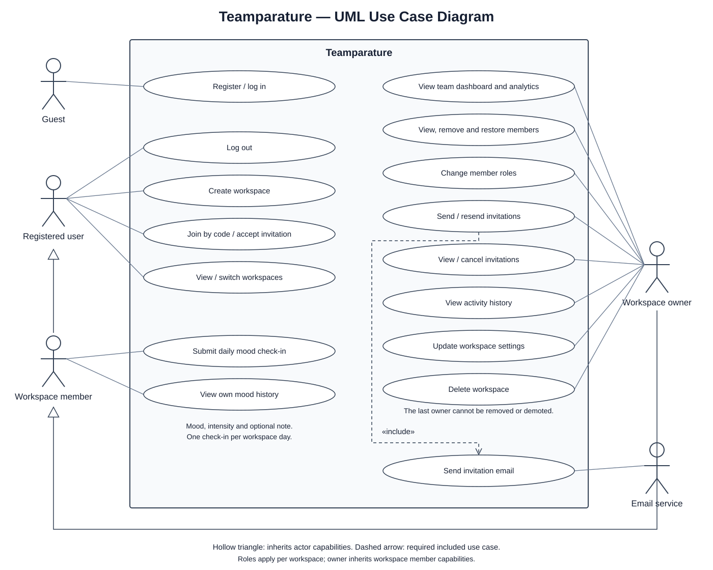

# Teamparature UML use case diagram

- `use-case-diagram.svg`: scalable diagram for viewing or inserting into reports.
- `use-case-diagram.puml`: editable PlantUML source.

## Scope

This diagram represents the implemented application, checked against the workspace, membership, invitation, activity, and mood API routes. Proposed backlog features such as reminders and follow-up actions are excluded.

## Actors

| Actor | Use cases |
| --- | --- |
| Guest | Register or log in. |
| Registered user | Log out; create a workspace; join using a code or accept an invitation; view and switch workspaces. |
| Workspace member | Submit a daily mood check-in and view personal mood history; inherits registered-user capabilities. |
| Workspace owner | View team dashboard and analytics; view, remove, and restore members; change roles; send, resend, view, and cancel invitations; view activity history; update workspace settings; delete a workspace. Inherits member capabilities. |
| Email service | Deliver invitation emails as an external supporting actor. |

## UML notation

The rectangle is the Teamparature system boundary. Ellipses represent use cases, and solid lines connect actors to their use cases. A hollow triangle points to the more general actor whose capabilities are inherited. The dashed `<<include>>` arrow from sending/resending invitations to sending invitation email identifies required behavior.

Related operations are grouped in some ellipses to keep this overview readable; a slash denotes alternative operations, not a required sequence. Authentication is a precondition for protected use cases, so it is not drawn as an included login on every action.

## Business rules

- Roles apply separately in each workspace.
- Check-ins contain a mood, intensity, and optional note. The API rejects another check-in during the same workspace day.
- Owners can submit their own check-ins as active members.
- The last active owner cannot be removed or demoted.
- Workspace settings include name, description, and timezone.
- Restoring a removed member assigns the member role.
- Workspace deletion requires the workspace name as confirmation.

## Implementation references

- `lib/rbac.ts`: owner and member permissions.
- `app/api/orgs/route.ts`, `app/api/orgs/join/route.ts`, and `app/api/me/memberships/route.ts`: workspace creation, joining, and listing.
- `app/api/invitations/accept/route.ts`: invitation acceptance.
- `app/api/orgs/[orgId]/manage/route.ts`: membership, role, invitation cancellation, settings, and deletion actions.
- `app/api/orgs/[orgId]/invite/route.ts` and `invite/[inviteId]/resend/route.ts`: invitation management.
- `app/api/orgs/[orgId]/moods/`: check-ins, mood history, and analytics.
- `app/api/orgs/[orgId]/activity/route.ts`: owner activity history.
