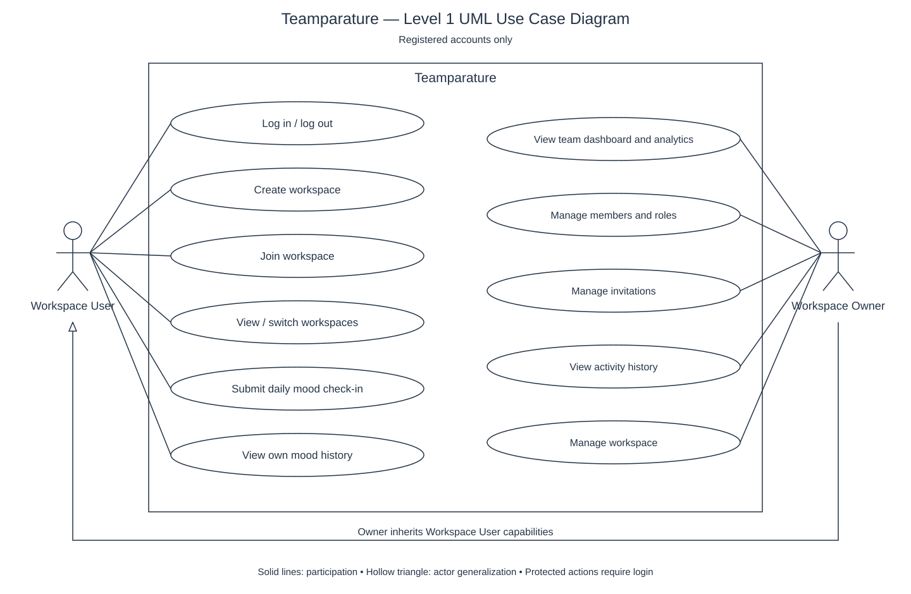

# Teamparature - Level 1 UML use case diagram

[Editable PlantUML source](use-case-level-1.puml)

Scope: registered accounts only. The two actors are Workspace User (a workspace member) and Workspace Owner. Registration and guest access are outside this diagram. Protected actions require login; workspace actions also require active membership and the appropriate role.

The owner inherits the user's common capabilities, including submitting a daily mood check-in and viewing personal mood history. Roles apply per workspace. Creating a workspace makes its creator the owner; joining requires a valid code or invitation.

This level 1 overview groups related operations: manage members and roles includes removal, restoration, and role changes; manage invitations includes sending, resending, and cancelling; manage workspace includes settings and deletion. These are grouped goals, not mandatory sequences.

UML notation: the rectangle is the system boundary, ellipses are use cases, solid lines show participation, and the hollow triangle points from Workspace Owner toward Workspace User to indicate inherited capabilities. Level 1 denotes major goals here; UML does not define numbered use case levels.
